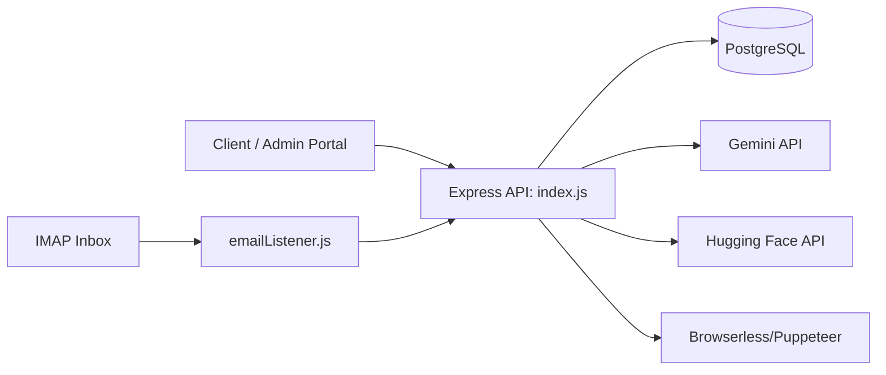

<div align="center">

# HackBuddy Backend

**An API-first backend for discovering hackathons, managing teams and submissions, and automating proof verification workflows.**


</div>

---

## Why this project exists

HackBuddy Backend powers a hackathon operations workflow: it stores hackathons, registrations, tasks, teams, and submissions, then layers AI-assisted scraping and proof verification on top.

It is designed as a single Express service with PostgreSQL persistence and optional integrations for Gemini, Hugging Face, Browserless, Firebase Auth, and IMAP email ingestion.

---

## Feature highlights

- **Hackathon lifecycle APIs** (create, update, list, delete)
- **Student workflow APIs** for registrations, tasks, submissions, leaderboard, and team invites
- **AI-assisted proof verification** for uploaded proof images
- **Automated hackathon scraping** from one or many URLs
- **Email-forward verification pipeline** for proof processing via IMAP
- **Auto database bootstrap + seed data** on server startup (`db.initDb()`)
- **Container-ready setup** with Dockerfile + pgvector-based `docker-compose.yml`

---

## Tech stack (from repository code)

| Layer | Technologies |
|---|---|
| Runtime | Node.js |
| Web API | Express 5, CORS, Multer |
| Auth | JWT, Firebase Admin, bcryptjs |
| Database | PostgreSQL (`pg`) |
| AI / extraction | Google Gemini (`@google/generative-ai`), Hugging Face Inference API, Puppeteer / `puppeteer-extra` |
| Email ingestion | `imapflow`, `mailparser` |
| Dev tooling | nodemon |

---

## High-level request flow



---

## Repository structure

```text
.
├── index.js                # Main API server and routes
├── db.js                   # DB pool, schema initialization, seed data
├── scraper.js              # Scraping and extraction helpers
├── emailListener.js        # IMAP-based forwarded-email proof processing
├── run_bulk_scraper.js     # CLI workflow for interactive bulk scraping
├── cleanup.js              # CLI cleanup for scraped hackathon rows
├── enable_rls.js           # Enables PostgreSQL RLS on listed tables
├── docker-compose.yml      # Local pgvector/Postgres service
├── Dockerfile              # Container image for API service
├── test-*.js               # Utility/manual test scripts
└── package.json
```

---

## Setup and installation

### Prerequisites

- Node.js + npm
- PostgreSQL database (or Docker + Docker Compose)

### 1) Install dependencies

```bash
npm ci
```

### 2) Configure environment

Create `.env` in the project root. Variables used by code:

| Variable | Required | Purpose |
|---|---|---|
| `DATABASE_URL` | Yes (for persistent DB) | PostgreSQL connection string |
| `PORT` | No | API port (default `3000`) |
| `HOST` | No | Bind host (default `127.0.0.1`) |
| `JWT_SECRET` | Strongly recommended | JWT signing secret |
| `FIREBASE_PROJECT_ID` | Optional | Firebase Admin project id |
| `GEMINI_API_KEY` | Optional | Enables Gemini-based verification path |
| `HF_TOKEN` / `Qwen_3b` | Optional | Hugging Face token for model calls |
| `BROWSERLESS_API_KEY` | Optional | Required for `/api/hackathons/bulk-extract` Browserless mode |
| `EMAIL_APP_PASSWORD` | Optional | Enables IMAP email proof processing |

> Keep real credentials out of git. `.env` is ignored by `.gitignore`.

### 3) Start PostgreSQL quickly (optional Docker path)

```bash
docker compose up -d db
```

This starts `pgvector/pgvector:pg16` on local port `5434` as configured in `docker-compose.yml`.

### 4) Run the backend

```bash
npm start
# or
npm run dev
```

On startup, the service initializes schema and seed rows via `db.initDb()`.

---

## API overview

Base URL (local): `http://127.0.0.1:3000`

### Health and diagnostics

- `GET /` – HTML landing page
- `GET /health` – JSON heartbeat
- `GET /test-db` – DB connectivity check

### Auth and users

- `POST /api/admin/login`
- `POST /api/auth/firebase`
- `GET /api/auth/me` (JWT required)
- `POST /api/users`
- `GET /api/users`

### Core domain APIs

- `GET/POST/PUT/DELETE /api/hackathons...`
- `POST /api/hackathons/scrape`
- `POST /api/hackathons/bulk-extract`
- `GET/POST/DELETE /api/registrations...`
- `GET/POST/PATCH/DELETE /api/tasks...`
- `GET/POST/PATCH /api/submissions...`
- `GET /api/analytics`
- `GET /api/leaderboard`

### Admin operations

- `POST /api/admin/verify-proofs`
- `POST /api/admin/schedule-verification`
- `GET /api/admin/analytics`

### Team workflow APIs (JWT required)

- `POST /api/teams/create`
- `GET /api/teams/invites`
- `POST /api/teams/accept-invite`
- `POST /api/teams/upload-proof`
- `GET /api/teams/:hackathonId`

### Example: health check

```bash
curl http://127.0.0.1:3000/health
```

Example response:

```json
{
  "ok": true,
  "service": "hackbuddy",
  "timestamp": "2026-10-18T10:00:00.000Z"
}
```

### Example: scrape one hackathon URL

```bash
curl -X POST http://127.0.0.1:3000/api/hackathons/scrape \
  -H "Content-Type: application/json" \
  -d '{"url":"https://example.com/hackathon"}'
```

---

## Development and operations

### Available npm scripts

- `npm start` → `node index.js`
- `npm run dev` → `nodemon index.js`

### Testing status

There is **no formal npm test script** in `package.json` right now. The repository contains utility/manual scripts (`test-scraper.js`, `test-imap.js`, `test-imap-flags.js`, `test_unstop.js`) for targeted checks.

### Data lifecycle note

A periodic cleanup in `index.js` deletes hackathons whose `registration_deadline` is older than 7 days (runs hourly).

---

## Security and configuration notes

- Configure a strong `JWT_SECRET` in production.
- Restrict/validate CORS origins for deployed environments.
- `isAdmin` middleware currently injects a fixed admin user (development shortcut in code); harden this before production use.
- Optional external integrations (Gemini/Hugging Face/IMAP/Browserless) should be enabled only with properly scoped credentials.

---

## Contributing

Contribution workflow is not explicitly documented in the repository yet. If you plan to contribute, open an issue/PR describing intent and testing steps.

---

## License

`package.json` declares **ISC** license. A standalone `LICENSE` file is not present in this repository at the time of writing.

---

## Suggested roadmap (documentation proposal)

- Add a versioned OpenAPI/Swagger spec for all routes
- Replace development admin bypass with role-safe production middleware
- Add automated tests and CI checks
- Document deployment profiles (local, container, cloud)
